# High-Ratio Wind Power System Energy Storage Operation and Configuration Analysis (Matlab Realization)

High-Ratio Wind Power System Energy Storage Operation and Configuration Analysis (Matlab Realization)
\n        \n      \n        \n      \n        \n      \n        \n  
\n        \n      \n        \n      \n        \n      \n        \n      \n        \n      \n        \n      \n        \n      \n        \n  

## Images

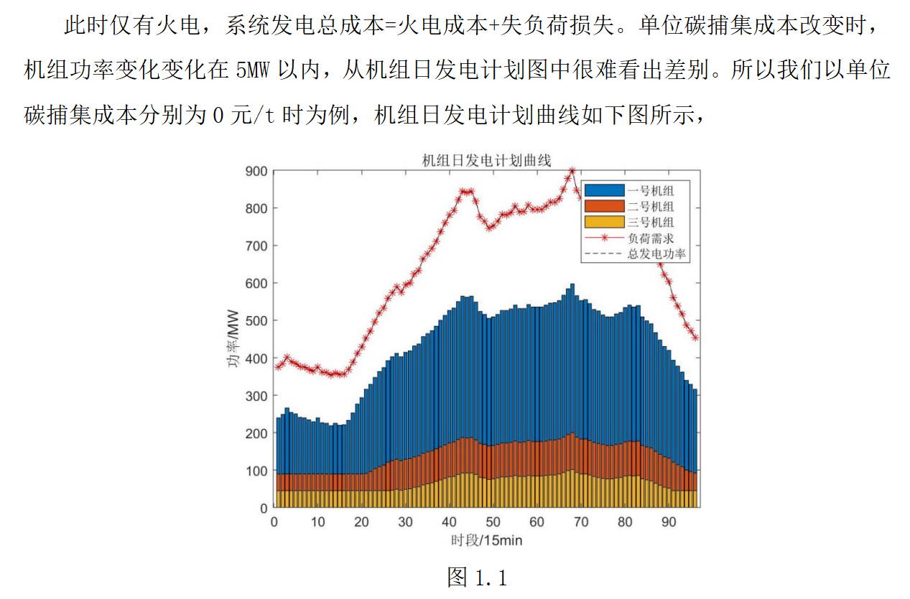
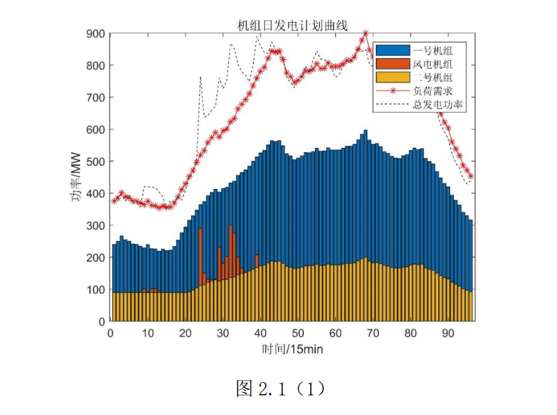
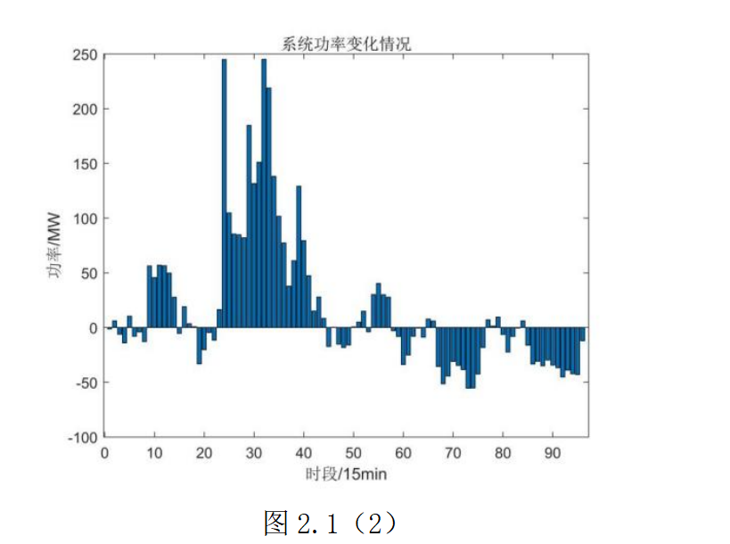
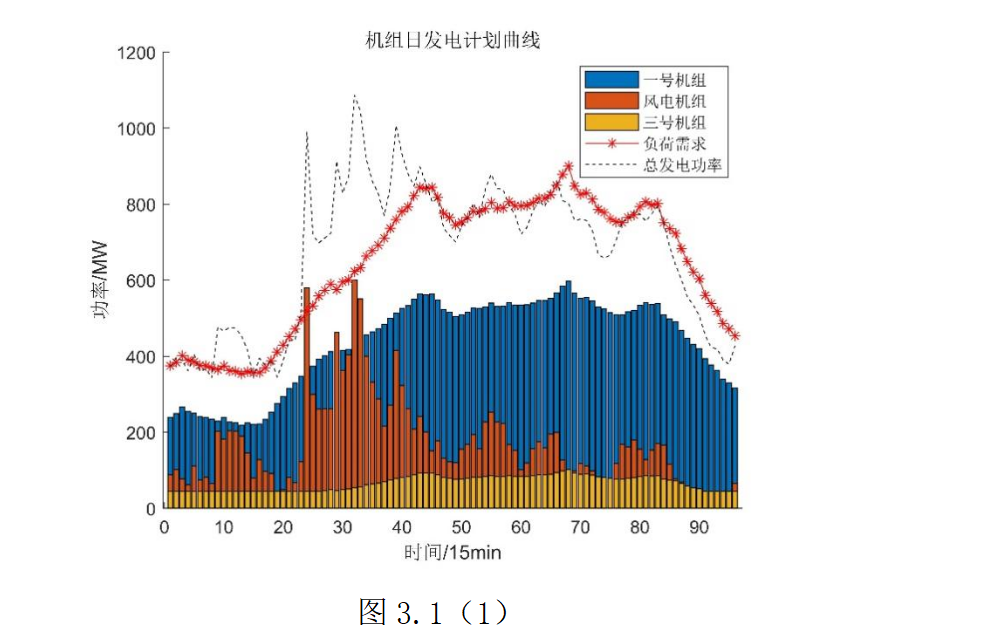
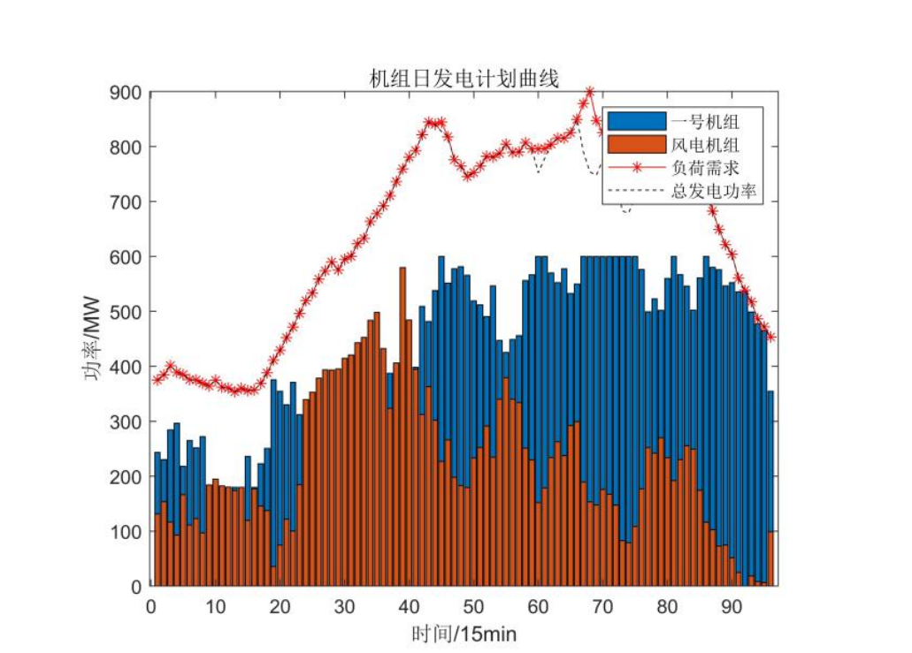
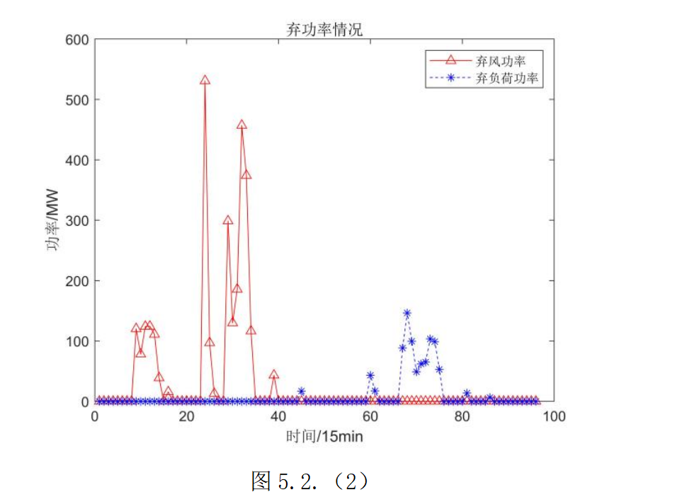
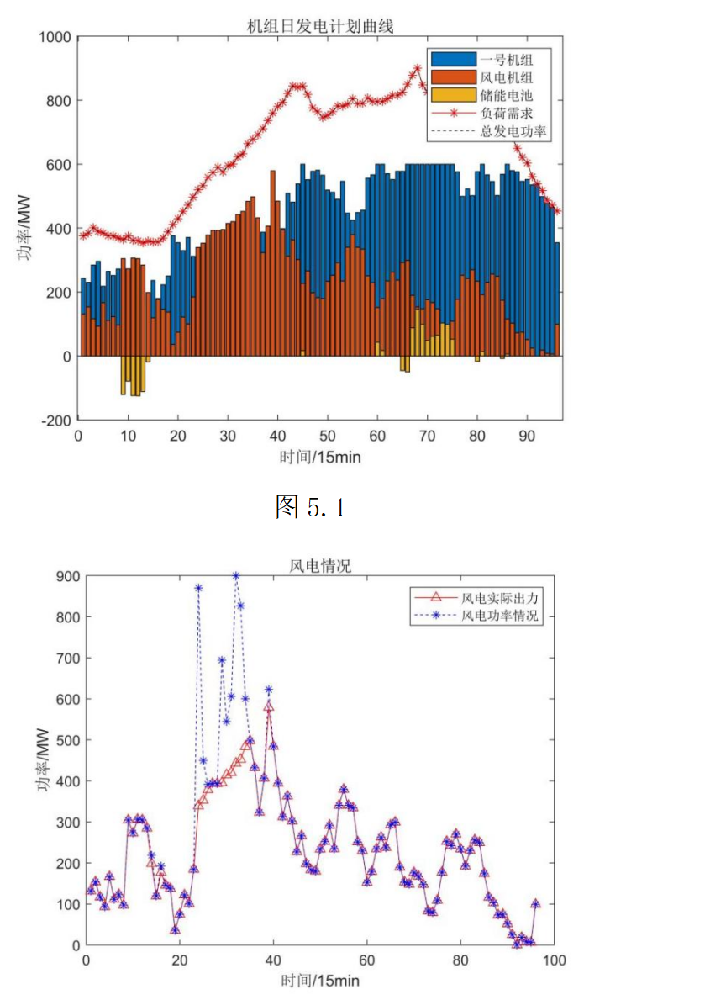
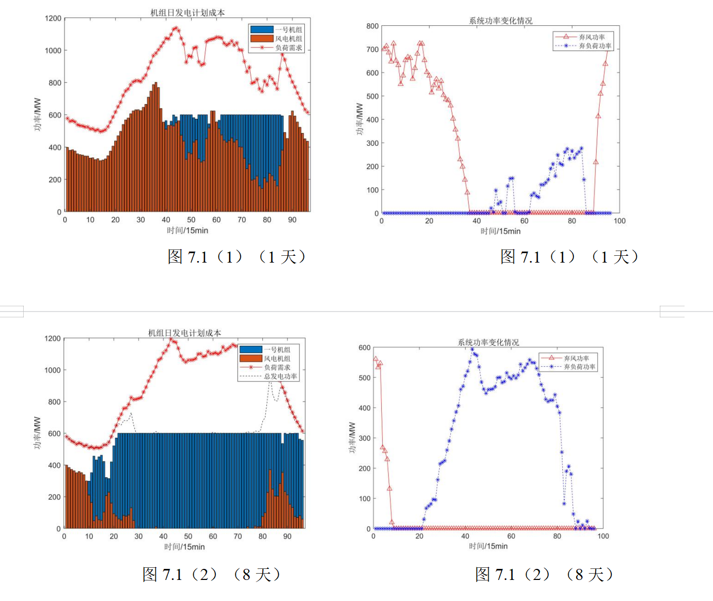
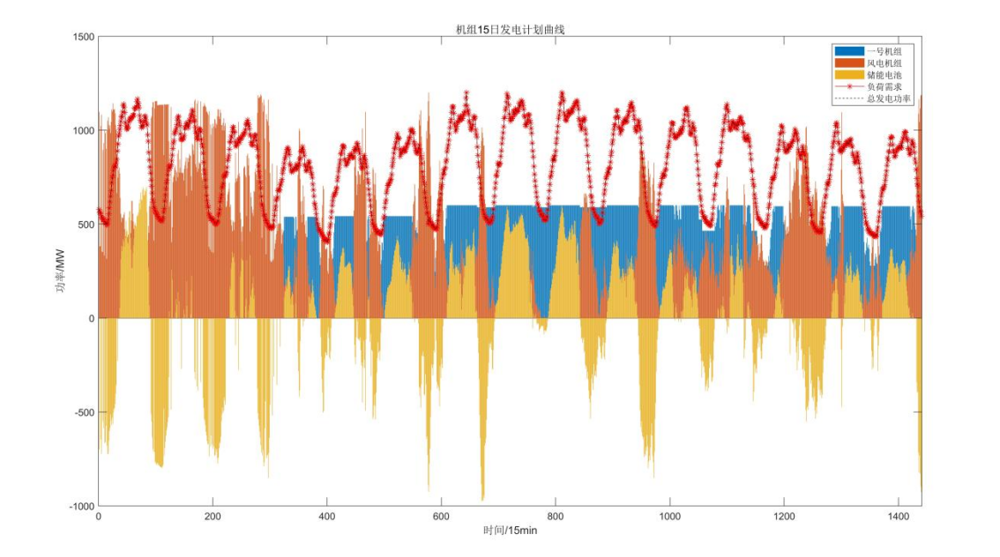
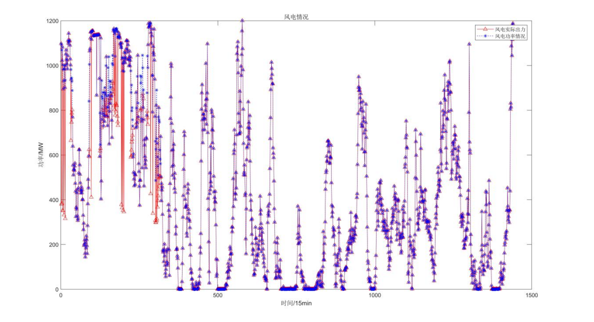
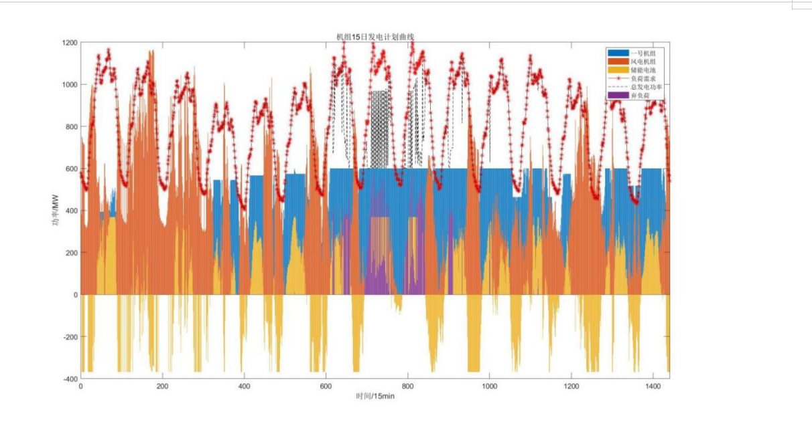
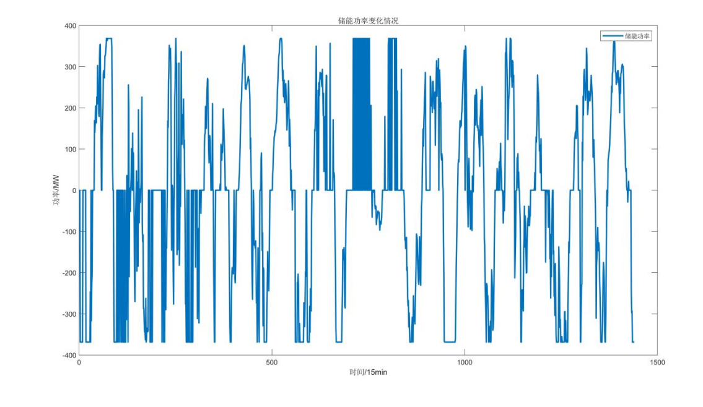

<!-- PAYMENT_BLOCK -->

## Get this dataset

- Payment link (Stripe): [Buy now](https://buy.stripe.com/3cs8yP7sY87d0vu9AB)
- Payment QR code: 

<!-- /PAYMENT_BLOCK -->
